# Micronaut Factory and Runtime Graphs

This map separates artifacts that already exist from the proposed factory bus. An edge means a declared dependency or data flow; it does not grant execution authority. The factory should produce reviewable bundles, while XCFE decides whether a route may execute.

## 1. Factory production graph

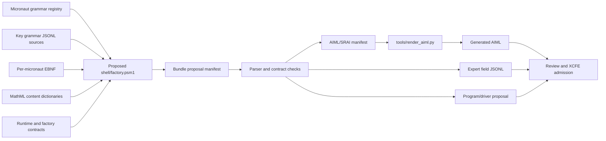

`data/grammar/micronaut-grammar-registry.json` names individual grammars and typed input/output roles. `data/grammar/factory-production.contracts.json` limits factory output to proposals; registration requires validation, authorization, and a driver. `tools/render_aiml.py` can render a validated basic AIML manifest now. **`shell/factory.psm1` and `factory.xsd` do not exist in this repository.** `data/schema/Micronaut.SRAI.AIML.xsd`, `data/schema/xcfe-aiml.xsd`, and `data/schema/Bindings.xsd` are existing schema inputs, not substitutes for a factory bundle schema.

## 2. One expert bundle

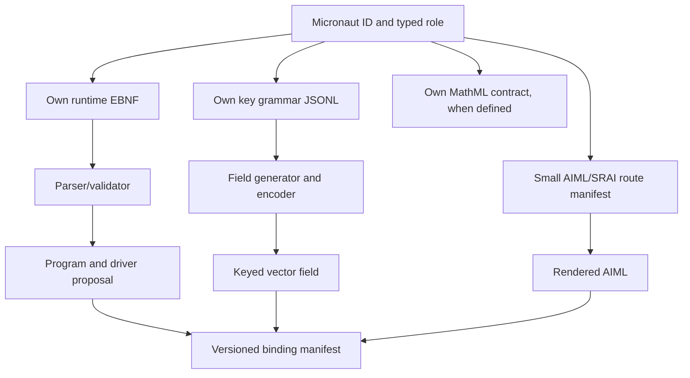

The registry currently lists `SNOBOL-µ`, `CFPC-µ`, `ADVISOR-µ`, `QUESTION-µ`, `CODEX-µ`, `CODEGEN-µ`, and `MX2LM-µ`. Their `implementation_status` values differ; a grammar entry alone is not a working parser or driver. Existing examples include `advisor-mu.runtime.ebnf`, `cfpc-mu.runtime.ebnf`, `codex-mu.runtime.ebnf`, `mx2lm-mu.runtime.ebnf`, and `snobol-mu.runtime.ebnf`. Shared surfaces are `micronaut.runtime-grammar.ebnf`, `micronaut-program.runtime-grammar.ebnf`, `aiml.runtime-grammar.ebnf`, and `typed-query.runtime-grammar.ebnf`.

## 3. Key grammar and vector evidence graph

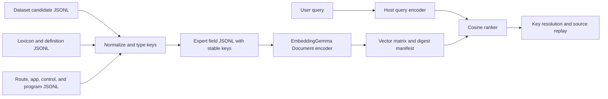

Dataset candidates are `dataset.key-grammar.candidates.jsonl` and the `dataset.{advisor_mu,joke_mu,mx2lm,plan_mu,politics_mu}` variants. Dictionary evidence is in `english-dictionary.lexicon.key-grammar.jsonl` and `english-dictionary.definition-relations.key-grammar.jsonl`. Route and structure sources include `advisor-bootstrap`, `joke-bootstrap`, `plan-bootstrap`, `asx-mini-app`, `cloud-model-chat`, `control-flow`, `css`, `foldgraph-lineage`, `kuhul-relational`, `micronaut-program`, `micronaut-route-contracts`, `ngram-key-grammar`, `self-hosted-forum`, and `socialsphere` key grammar JSONL files. `control-capability-gaps.jsonl` is candidate evidence for the factory, not an executable capability.

The current `tools/key_grammar_fields.py` compiles six bounded JSONL sources into 183 candidate fields; it does not yet cover every source above. Each expert needs a declared source-to-key binding and a separate response policy before ranked fields can affect chat.

## 4. Conversation and authority graph

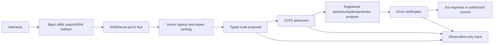

`runtime-graph.contracts.json` defines legal topology, while `vector-ingress.contracts.json` and `vector-mu.contracts.json` keep similarity separate from identity and permission. `srai-operators.contracts.json` defines typed dispatch proposals. `xcfe-aiml.contract.json`, `xcfe-modes.contracts.json`, and `xcfe-policy.contracts.json` govern admission; `daemon-bot.trace.contracts.json` describes observation only. `word-domains.v1.json` supplies domain vocabulary, not executable graph edges. The current bus emits source-bound greeting and control-key descriptions; it does not execute arbitrary expert programs.

## 5. MathML and grammar authority graph

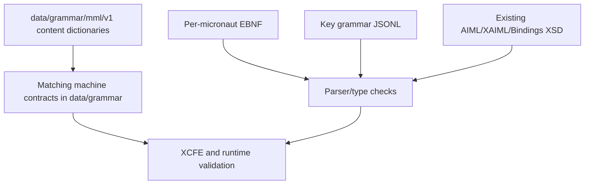

`mml/v1/SraiOperators.mml`, `MicronautPatterns.mml`, `XaimlMicronautDispatch.mml`, `DaemonBehaviorModes.mml`, and `daemon-factory.mml` express distinct operator, pattern, dispatch, mode, and factory laws. The phase-driver files cover Pop, Wo, Yax, Sek, Ch'en, and Xul; daemon and CODEGEN dictionaries add domain-specific laws. These MathML files are contract sources. A factory must validate references and types against them; it must not treat an MML declaration as a compiled implementation.

## Factory bundle contract to add

A proposed bundle should identify `{micronaut_id, grammar_ref, key_source_refs, mml_refs, aiml_manifest, program_ref, driver_ref, source_digests, authority: proposal_only}`. The factory should reject missing files, duplicate keys, unsupported AIML tags, unresolved SRAI targets, mismatched phases, and unregistered program operations. It should publish outputs only after all generated files parse and their digests match. Registration and execution remain separate XCFE-controlled steps.

## Low-score query to expert loop

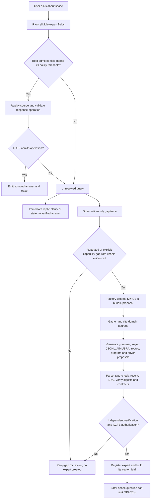

The threshold is a response-policy gate, not a universal cosine constant. The current key-grammar bus uses 0.80 for literal greetings and 0.75 for explicit control-word descriptions; a SPACE-µ response policy would need its own calibrated threshold, margin, context checks, and source requirements. A low score alone does not prove that an expert is missing: the query may be ambiguous, the encoder or index may be stale, or the relevant source may be outside the current read scope.

The live request must finish without waiting for factory production. Store the utterance, candidate keys and scores, model/index digests, route decision, and missing-capability label as **observation-only** trace data. The factory may use repeated gaps or an explicit build request to propose an expert, but it must not convert a trace into permission, invent facts, or auto-register a program. If admitted later, SPACE-µ owns its source-backed field records and small AIML/SRAI entry routes; a new query still passes ranking, source replay, and response admission before text is emitted. The existing bus currently ends at the fallback and trace side of this loop; factory proposal, registration, and SPACE-µ are planned components.

## 6. ELIZA bias projection graph

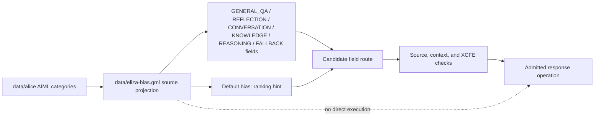

`data/eliza-bias.gml` already binds AIML category nodes to field nodes with `contains_aiml_category` edges. Its own header says `authority "data_only"`, `admission "xcfe_required"`, and `bias_semantics "default ranking hint only; learned bias is separate"`. The category nodes retain pattern, source, source hash, XML, wildcard count, and projection order. This makes the graph useful as a candidate-routing input for the factory and future expert fields; it does not turn its `<mx2lm>` templates into executable programs. Its declared `source_manifest` points to `vendor/key-grammar-kit/data/eliza-field.sources.json`, which is absent from this checkout; a local `data/eliza-field.sources.json` exists and must be identity-checked before substituting it.

## 7. Continuation and π bias graphs

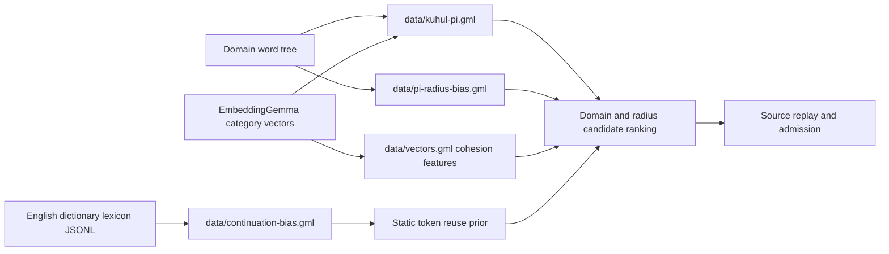

`continuation-bias.gml` contains 4,000 weighted token nodes derived from definition reuse counts. Its weight is a static continuation prior, not a word meaning, truth score, or expert answer. The graph header names `tools/build_continuation_bias.py`, but that generator is absent from this checkout; provenance must be checked before regeneration. `kuhul-pi.gml` carries six-component `V_π` node features and declared domain-tree edges. `pi-radius-bias.gml` supplies a separate depth prior for `W_pi_routing`; `vectors.gml` supplies semantic cohesion features. Their source paths currently point into `.ui-shell`, so the factory must bind local source/vector identities before using them as verified inputs. None of these weights bypasses the response-policy threshold or XCFE gate.

## 8. Behavior and emotion presentation graphs

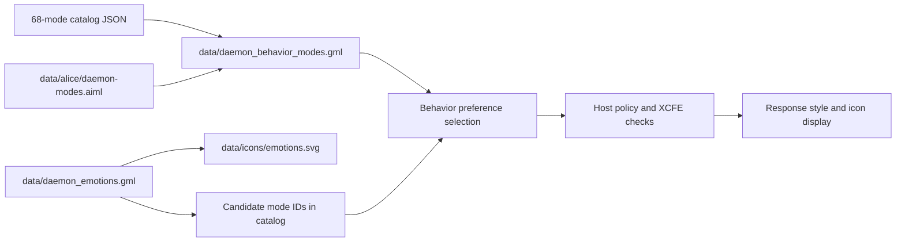

`daemon_behavior_modes.gml` is a partial affinity graph: 12 shipped nodes and 9 edges over the 68-mode catalog. Its edge weights are preferences, not probabilities. The new `daemon_emotions.gml` has eight emotion-cue nodes, eight catalog mode references, ten `presentation_candidate` edges, and SVG icon references in `data/icons/emotions.svg`. These cue-to-mode edges are illustrative presentation suggestions, not diagnoses or inferred user emotions. The icon sprite provides display metadata; the current WPF shell has no emotion-icon renderer yet. Mode selection cannot change phase, permission, or learned weights.

## 9. Bootstrap, wildcard, and runtime topology

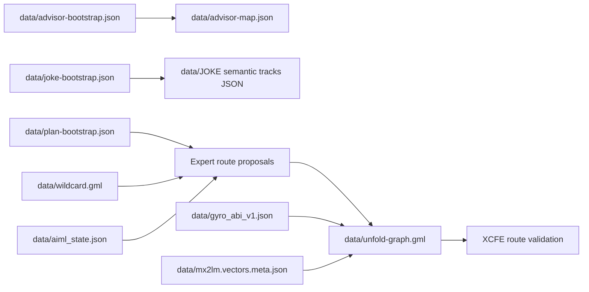

The bootstrap JSON files author candidate routes; `advisor-map.json` records an XCFE-gated projection of the advisor bootstrap. `wildcard.gml` declares pattern/capture topology without weights. `aiml_state.json` currently contains only a topic field, so it is session context rather than expert knowledge. `unfold-graph.gml` is the Q3 × C6 runtime topology; `gyro_abi_v1.json` maps measurement tracks to epistemic coordinates; `mx2lm.vectors.meta.json` describes the separate large trigram vector snapshot. `data/greeting-bank.json` supplies phase-scoped greeting templates and placeholder rules, while `data/grammar/greeting-bank.key-grammar.jsonl` supplies keyed fields for ranking. Keep these layers distinct when generating expert bundles.

## 10. Local generative Gemma path

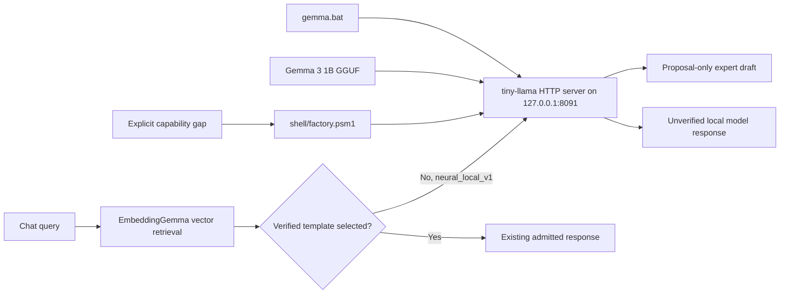

`gemma.bat` starts `C:\Users\canna\.llama-win-cpu-x64\llama-server.exe` with `C:\Users\canna\.models\gemma-3-1B-it-QAT-Q4_0.gguf`. The Windows CPU bundle includes `ggml-cpu-haswell.dll` for compatible Haswell processors; the server selects its backend. This **generative** Gemma 3 model is distinct from the pinned **EmbeddingGemma 2** encoder used to rank fields. The shell client is `shell/GemmaNeural.psm1`; `shell/factory.psm1` uses it to draft a bundle from an explicit capability gap without writing or registering anything. The bus exposes `factory.draft` and `gemma.neural.health`. Chat can request `responseMode: "neural_local_v1"` (WPF command `/gemma <question>`) to call the model after verified vector retrieval falls back. Model text is marked `model_output_unverified`; it is not a verified source answer, XCFE admission, or a persistent expert. The default chat route retains the existing no-verified-answer fallback when the neural mode is not requested.

The bus also exposes `gemma.neural.identity` so clients can distinguish the optional text continuation from `gemma.identity`, whose `GEMMA-µ` descriptor remains `rank_only`. A query vector is an embedding produced by a neural encoder; it is not itself a neural network or a set of trainable weights. The Gemma 3 model supplies generated text only after the explicit continuation route is selected.

For code tasks, AIML `<code language="cpp">…</code>` and `<code language="typescript">…</code>` are response content, not learning instructions. `coder.grammar` compiles the existing code grammar patterns, parses source, generates bounded code proposals, and validates a Gemma-proposed AST against a fresh parse. A validated proposal may be reviewed for LEARN-µ; this repository does not yet automatically send AIML code tags or model output to LEARN-µ or register factory drafts as experts.

## 11. Runtime grammar families and terminal routing

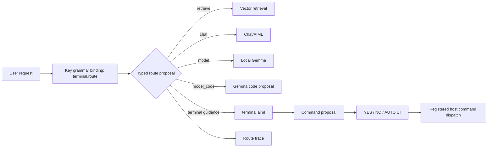

`data/alice/terminal.aiml` supplies small command intent patterns; `shell/terminal.bindings.psm1` classifies requests through `terminal.route`, and the WPF shell selects the supported response mode. A terminal route is not shell execution. Command proposals appear for host confirmation; dispatch must remain limited to named host commands. AUTO is session-scoped and limited to read-only commands. AIML guides intent handling, while key grammar bindings and the host perform typed routing and dispatch.

The additional EBNF files map into these graph layers:

| Layer | Grammar sources | Graph role |
| --- | --- | --- |
| Conversation and control | `aiml.runtime-grammar.v4.ebnf`, `aiml.runtime-grammar.v5.ebnf`; `scfml.runtime-grammar.v1.ebnf`, `v2.ebnf`, `v3.ebnf` | AIML categories and templates feed SCFML control-flow normalization before host routing. Keep versioned contracts distinct; do not silently treat a newer grammar as proof that the runtime implements it. |
| Program composition | `program.grammar.ebnf`, `micronaut.runtime-grammar.v2.ebnf` | Shared program syntax composes typed Micronaut declarations and calls; registry entries still need concrete parser and binding implementations. |
| Pattern and regex | `script-pattern.runtime-grammar.ebnf`, `script-pattern.runtime-grammar.v2.ebnf`; `regex-kuhul.runtime-grammar.ebnf`, `v1.ebnf`, `v2.ebnf`; `regex-fsm.runtime-grammar.ebnf` | Pattern text is parsed into regex/FSM structure, then mapped to K'UHUL phases. This is a parse/transform lane, not permission to evaluate arbitrary patterns. |
| Key and retrieval | `ngram-key-grammar.runtime-grammar.v2.ebnf` | Defines typed n-gram key structure used to address indexed fields; keys support retrieval and ranking, not response authority by themselves. |
| Domain experts | `npc-theory.runtime-grammar.ebnf`, `npc-theory.runtime-grammar.v2.ebnf`; `eliza-reasoning.ebnf`; `geometric-coder-mu.runtime-grammar.ebnf`; `snobol-mu.runtime-grammar.ebnf`; `wildcard-micronauts-mu.runtime-grammar.ebnf`; `tool-control-mu.runtime-grammar.ebnf` | Expert-specific reasoning, code geometry, pattern matching, wildcard capture, and tool proposal grammars. Each must bind to its own data and program before dispatch. |
| Geometry and ranking | `kuhul-pi.ebnf` | Pi comparison, radius, proximity, and routing signals feed candidate ranking; they remain bias/features until response validation and host admission. |

The versioned files coexist as authored grammar sources. Before a factory upgrades an active route, it should record the chosen version, compare productions and contracts, verify the consuming parser, and preserve older fixtures for compatibility. `program.grammar.ebnf` is the composition point; domain grammars describe typed surfaces and do not independently grant execution authority.

`tools/gml-to-aiml.py` exports graph metadata as separate lookup banks under `data/alice/graphs/`. It preserves source filename, graph label/schema, authority metadata, node attributes, and edge endpoints in data-only templates. `gml.cpp` remains the CCC4-specific 64-node/96-edge topology validator; it is not the general exporter. Large projections such as `eliza-bias.gml` and `continuation-bias.gml` produce large AIML banks, so select them explicitly when rebuilding a runtime corpus.
