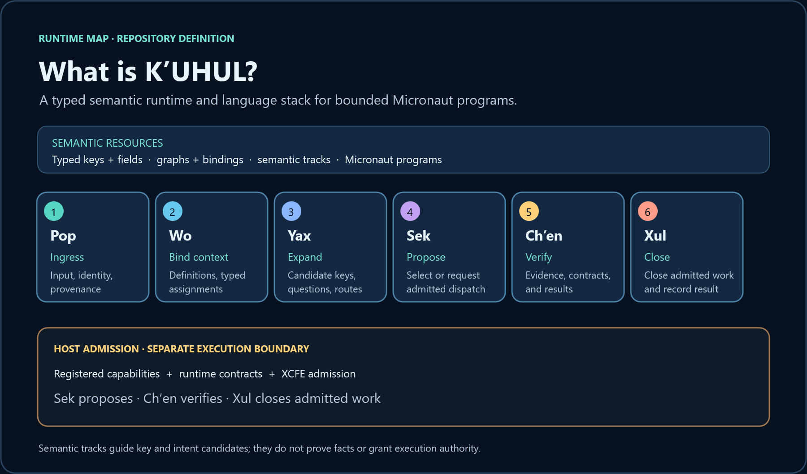

<div align="center">
  

  <h1>eliza-µ &mdash; Micronaut Daemon</h1>
  <p>C++17 AIML runtime · K'UHUL phase-gated execution · SRAI semantic routing · OpenCL attention kernels</p>
</div>

---

## What is K'UHUL?

**K'UHUL is a graph-native, phase-governed computational language and runtime in which graph topology defines program structure, glyphs and node operators encode executable semantics, and a controlled hylomorphic cycle unfolds candidate structures, validates their authority, and folds admitted results into committed state.**

A K'UHUL program isn't a list of instructions — it's a constrained topology of possible transformations. Execution is the phase-governed traversal and resolution of that topology.

| Phase | Role | Algebra |
|-------|------|---------|
| Pop | Corpus entry, key grammar, context capture | — |
| Wo | Intake, planning, field binding | Ana gate (unfold begins) |
| Yax | Admission, candidate expansion, WCR scoring | — |
| **Sek** | **Proposal generation, GML traversal** | **Anamorphism** |
| **Ch'en** | **Evidence accumulation, proof** | **Verification gate** |
| **XCFE** | **Authority enforcement** | **Admission boundary** |
| **Xul** | **Compare, commit, collapse** | **Catamorphism** |

`hylo = cata ∘ ana` — the full Pop→Xul cycle is a hylomorphism extended with context (Pop/Wo/Yax), a two-step authority gate (Ch'en proves, XCFE authorizes), and controlled persistence (Xul commits only what XCFE admitted).

**Three computational layers:**

| Layer | Responsibility |
|-------|---------------|
| GML topology (`B`) | Defines the shape of possible transformations — `topology-before-coordinates` |
| Node operator fields | Encode behavior within that topology (`operator`, `authority`, phase bindings) |
| Phase / XCFE runtime | Traverses, validates, and controls what executes |

The graph is not merely input to an external algorithm. The graph *is* the program. Glyphs and node operators are its executable instructions.

K'UHUL treats graph topology as a **machine-executable computational space**. Nodes encode operations and state, edges encode relationships and dependencies, and phase-governed traversal transforms that space without requiring any visual rendering.

Three architectural invariants govern execution:

| Invariant | Statement |
|-----------|-----------|
| Topology precedes geometry | `GRAPH_TOPOLOGY ≠ VISUAL_PROJECTION` — coordinate fields are projection metadata, not the topology |
| Computation does not imply authority | `GPU_RESULT ≠ PROOF ≠ AUTHORIZATION ≠ COMMIT` — DirectML / OpenCL kernels produce candidate evidence, not authorized effects |
| The graph defines the program | `GRAPH + NODE_OPERATORS + PHASE_SEMANTICS = EXECUTION_STRUCTURE` |

GPU work (`dml_gemm.dll`, `gl_infer_driver.dll`, `vector_lane.cl`) may execute speculatively to produce candidate evidence before authorization. No candidate result may cross into authorized state or persistent commit without Ch'en proof + XCFE authorization + Xul gate.

---

## Overview

`eliza-µ` is a lightweight, embeddable chat daemon built on the Alice AIML corpus (99,524 categories). It speaks a line-delimited JSON protocol, serves an HTTP API, and routes all inference through a typed six-phase K'UHUL execution cycle. SRAI redirects are resolved via EmbeddingGemma vector retrieval rather than pure string matching, turning `<srai>` into a semantic routing mechanism for Micronaut atomic workflows.

## Large Assets

Three corpus files exceed GitHub's 100 MB limit and are stored as zip archives. Unzip before building or running:

```powershell
Expand-Archive data\alice\ag-news\ag-news-train.aiml.zip    data\alice\ag-news\
Expand-Archive data\grammar\english-dictionary.lexicon.key-grammar.jsonl.zip  data\grammar\
Expand-Archive data\ingest\english-dictionary.lexicon.key-grammar.jsonl.zip   data\ingest\
Expand-Archive data\vectors.svg.zip  data\
```

## Build

```powershell
cmake -S . -B build
cmake --build build --config Release
```

Output: `../bin/eliza-µ.exe`

Prepare the AIML corpus before first run:

```powershell
python aiml_to_gguf.py aiml-en-us-foundation-alice build\alice.aiml.jsonl
```

External dependency: `vendor/nlohmann/json.hpp` — single-header nlohmann/json v3.11.3, committed in-repo.

## Run

**JSONL mode** (line-oriented JSON protocol):

```powershell
echo {"@kind":"micronaut.request.v1","op":"chat.generate","id":"r1","prompt":"Hello","stream":true} | ..\bin\eliza-µ.exe
```

**Chat mode:**

```powershell
..\bin\eliza-µ.exe --chat "Hello"
```

**HTTP mode** (default port 9879):

```powershell
..\bin\eliza-µ.exe --http
# GET  /health
# POST /api/chat              { "prompt": "..." }
# POST /v1/chat/completions   OpenAI-compatible
```

Override corpus path: `--aiml-corpus PATH` or `MICRONAUT_AIML_CORPUS` env var.

## SRAI Semantic Routing

AIML `<srai>` normally redirects to another pattern by exact string. The daemon extends this into a three-component semantic routing system.

### AIML-SRAI-ROUTER-µ

`data/micronauts/aiml-srai-router.v1.json` — schema `kuhul.micronaut.semantic-router.v1`

The router walks the K'UHUL phase cycle with bounded authority at each step:

| Phase | Responsibility |
|-------|---------------|
| Pop | Capture surface and explicit context |
| Wo | Normalize, match registered rules, bind wildcard captures |
| Yax | Expand bounded SRAI redirects and semantic candidates |
| Sek | Rank candidates and form a route proposal |
| Ch'en | Verify phase order, captures, cycles, and XCFE admission |
| Xul | Close the verified data route — no executable commit in this API |

Constraints: `srai_max_depth=16`, `cycle_policy=reject`, wildcard priority `exact > _ > *`. Vector ranking uses `google/embeddinggemma-2` (256-dim) against `io/aiml-grams/aiml-relations-grams.json`.

### aiml.srai.vector

`data/micronauts/aiml-srai-vector.micronaut.json` — phase Yax, shared block

Embeds the SRAI target query with EmbeddingGemma, retrieves top-5 nearest AIML categories from pre-built `pattern_vectors.f32.npy` / `template_vectors.f32.npy`, filters by wildcard-count compatibility and field scope, re-ranks by `default_bias × cosine_score`, then follows the SRAI chain up to depth 3.

```
EMBED → RETRIEVE → FILTER → RANK → SRAI → FOLD
```

The resolved candidate is packaged as a typed `aiml.srai.vector.proposal`. XCFE admission is required before dispatch — vector similarity alone does not authorize execution.

**Consumers:** `ELIZA-µ`, `VECTOR-µ`, `PATTERNS-µ`, `TOOL-µ`

### eliza.srai.bridge

`data/micronauts/eliza-srai-bridge.micronaut.json` — phase Ch'en, atomic block

Bridges ELIZA-µ's Ch'en accumulator to the vector SRAI chain:

```
Ch'en accumulator → SRAI_DETECT → ROUTE_RESOLVE → PROPOSAL (pending XCFE)
```

If the matched template contains `<srai>...</srai>`, the bridge delegates to `aiml.srai.vector` with wildcard captures substituted. Terminal patterns (no SRAI) are wrapped directly into a routing proposal. The output `eliza.srai.routing_proposal` must be XCFE-admitted before `Xul` template fill proceeds.

**XCFE invariants:**
- `eliza.reflect` (Xul template fill) must not execute unless routing proposal status is `xcfe_admitted`
- `gramWrite` keys (`eliza:last_response`, `eliza:active_field`, `eliza:match_score`) are gated by principal and memory scope — not automatically authorized by proposal admission
- `field_score` computation is `data_only` — ranking evidence is preserved in provenance, not promoted to fact

## K'UHUL Phase Cycle

The phase-gated execution cycle: `pop → wo → yax → (SEK_PI_RADIUS kernel) → sek → chen → xul`

Each helper (`pop.cpp`, `wo.cpp`, `yax.cpp`, `sek.cpp`, `chen.cpp`, `xul.cpp`) validates its current phase and advances only along the legal cycle declared in `phase.hpp`.

**SEK_PI_RADIUS** (glyph `⊙`, `pi_radius.cpp`) — executes only while `kuhul::phase::Name` is `Sek`. Consumes `positions [points, dimensions]` and a positive `radius` scalar, writes `pi_radius_weights [points, points]` using the compact-support cosine radial function:

```
w(d) = 0.5 × (1 + cos(π × d / radius))   for d ≤ radius
w(d) = 0                                   otherwise
```

**OpenCL kernels:** `vector_lane.cl`, `attention.cl`, `micronaut.cl` — CMake copies each next to its target executable post-build.

## Architecture

| Source | Role |
|--------|------|
| `main.cpp` | Entry point, mode dispatch |
| `aiml_runtime.cpp` | JSONL/GGUF corpus reader, category matcher, AIML session runtime |
| `xcfe_router.cpp` | Op routing layer — dispatches XCFE frames |
| `scxq2_runtime.cpp` | JSONL → SCXQ2 frame → XCFE route |
| `gemma_bridge_route.cpp` | Gemma inference bridge |
| `semantic_bridge.cpp` | Relational-graph semantic lookup |
| `query_attestation.cpp` | Attestation key validation (`.env` → `MICRONAUT_GEMMA_ATTEST_KEY`) |
| `pi_radius.cpp` | SEK_PI_RADIUS attention kernel (glyph `⊙`) |
| `phase_gate.cpp` | Phase enforcement and transition |
| `kuhul_runtime.cpp` | K'UHUL phase cycle host |
| `vector_plan.cpp` | Vector operator plan |
| `http_server.cpp` | Loopback HTTP listener |
| `opencl.cpp` | OpenCL context and kernel dispatch |

## Tests

Run test executables directly — `npm test` is intentionally broken:

```powershell
.\build\Release\test_vector_plan.exe
.\build\Release\test_semantic_bridge.exe
.\build\Release\test_gemma_bridge_route.exe
python tools/test_fold_pair.py
```

## AIML Corpus

The Alice corpus compiles to 99,524 categories. The runtime supports wildcard pattern matching, topic/that constraints, captures, `<srai>`, predicates, `<condition>/<li>`, `<random>`, and common text transforms. `<learn>` cannot mutate the loaded read-only corpus at runtime.

**Corpus formats:**
- **JSONL** — native line-oriented format, default output of `aiml_to_gguf.py`
- **GGUF** — optional packaged form; pass `.gguf` extension to `aiml_to_gguf.py`. A GGUF data container, not neural-network weights.

Inspect either format without the AIML directory:

```powershell
python aiml_to_gguf.py --inspect build\alice.aiml.jsonl
```

## Training Pipeline

**Tokenize the corpus:**

```powershell
python tokenize_aiml.py `
  --input build\alice.aiml.jsonl `
  --tokenizer-json E:\models\GPT2\gemma_toolcall\merged\tokenizer.json `
  --tokenizer-config E:\models\GPT2\gemma_toolcall\merged\tokenizer_config.json `
  --model-config E:\models\GPT2\gemma_toolcall\merged\config.json `
  --output build\alice.gemma_toolcall.tokens.bin
```

The `.bin` is a headerless stream of little-endian `uint32` token IDs. Its adjacent `.bin.json` records the tokenizer model, counts, and SHA-256 hashes.

**Train a compact Gemma 3 model from scratch (CPU):**

```powershell
python train_gemma3_scratch.py `
  --tokens build\alice.gemma_toolcall.tokens.bin `
  --tokenizer-dir E:\models\GPT2\gemma_toolcall\merged `
  --model-config E:\models\GPT2\gemma_toolcall\merged\config.json `
  --output build\alice-gemma3-scratch-cpu `
  --steps 200 --threads 4 --sequence-length 32 `
  --hidden-size 32 --heads 4 --layers 2 --intermediate-size 64
```

**GPU trainer (D3D11):** `tools/bin/gpt2_trainer.exe`, work dir `tools/d3d11-build`. Launch from the WebGL2 Trainer Dashboard:

```powershell
pwsh -STA -File .\tools\trainer-dashboard\webgl2-trainer-dashboard.ps1
```

## WPF Dashboards

All WPF apps require PowerShell 7+ in STA mode (`pwsh -STA`):

| Script | Purpose |
|--------|---------|
| `Micronaut.ps1` | Chat UI — connects to `eliza-µ` |
| `tools/trainer-dashboard/webgl2-trainer-dashboard.ps1` | WebGL2 / XSHARD / D3D11 trainer |
| `tools/trainer-dashboard/micronaut-factory-dashboard.ps1` | Factory + evolution dashboard (ports 17474 / 8764) |
| `tools/trainer-dashboard/mx2_integration.ps1` | MX2LM bridge integration |
| `tools/trainer-dashboard/css_micronaut_pigccp_bridge.ps1` | CSS-C / PIGCCP protocol bridge |

## CSS-C Native Runners

`.CSS-C/native/` has its own independent build (requires MSVC dev shell):

```powershell
# From a VS x64 dev shell
cd .CSS-C\native
build.cmd release
```

Produces `cssc_gate_run.exe`, `cssc_klsl_run.exe`, `cssc_softmax_run.exe`, and related runners.

## External Dependencies

| Path | Used by |
|------|---------|
| `vendor/nlohmann/json.hpp` | C++ build — in-repo single header |
| `C:\Users\canna\.key-grammar-kit\` | Key-grammar manifests and test suite |
| `E:\models\_khanary_inspect\.Powernaut-v1.0.0\Kuhul3D.psm1` | K3D infographic renderer |
| `tools/bin/gpt2_trainer.exe` | Factory dashboard D3D11 trainer — in-repo |

`.env` holds `MICRONAUT_GEMMA_ATTEST_KEY` — excluded from commits.
